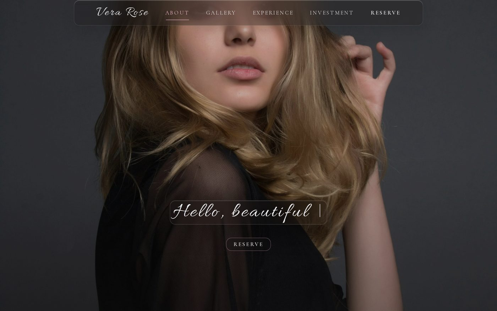
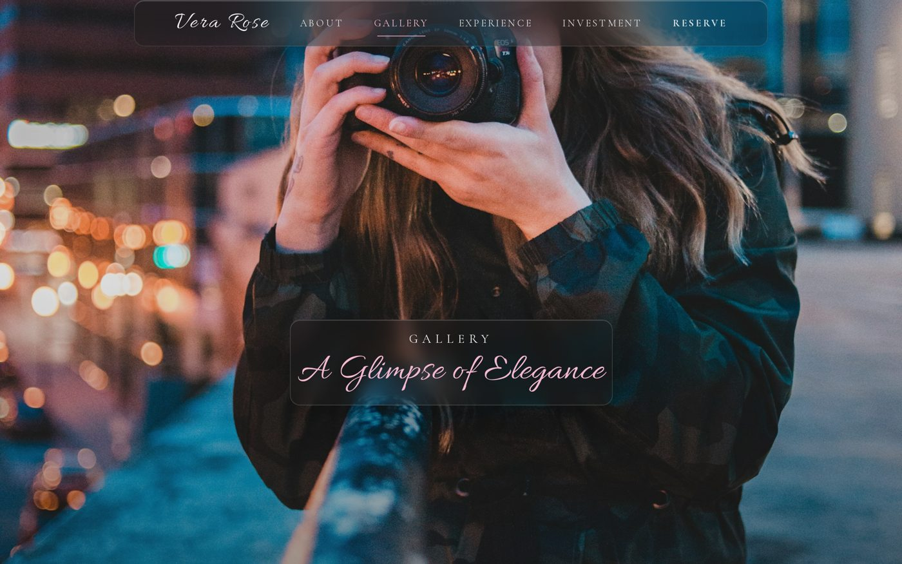
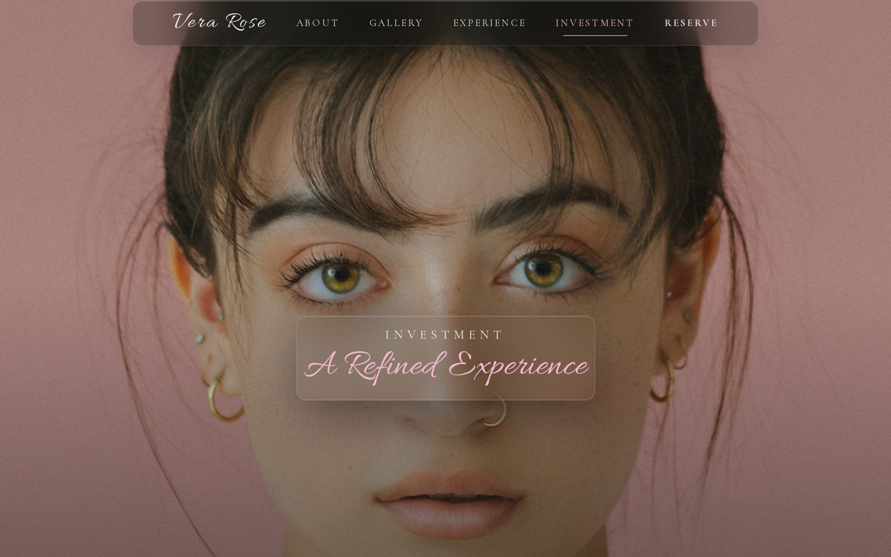
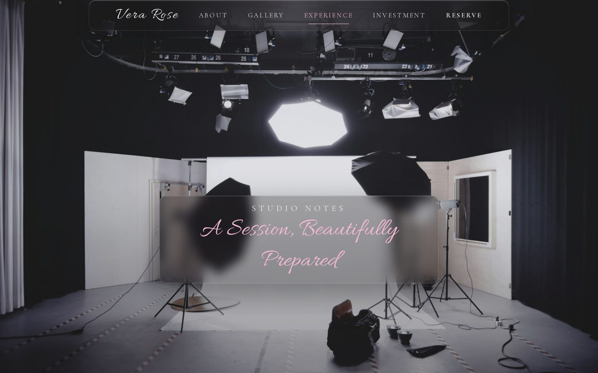
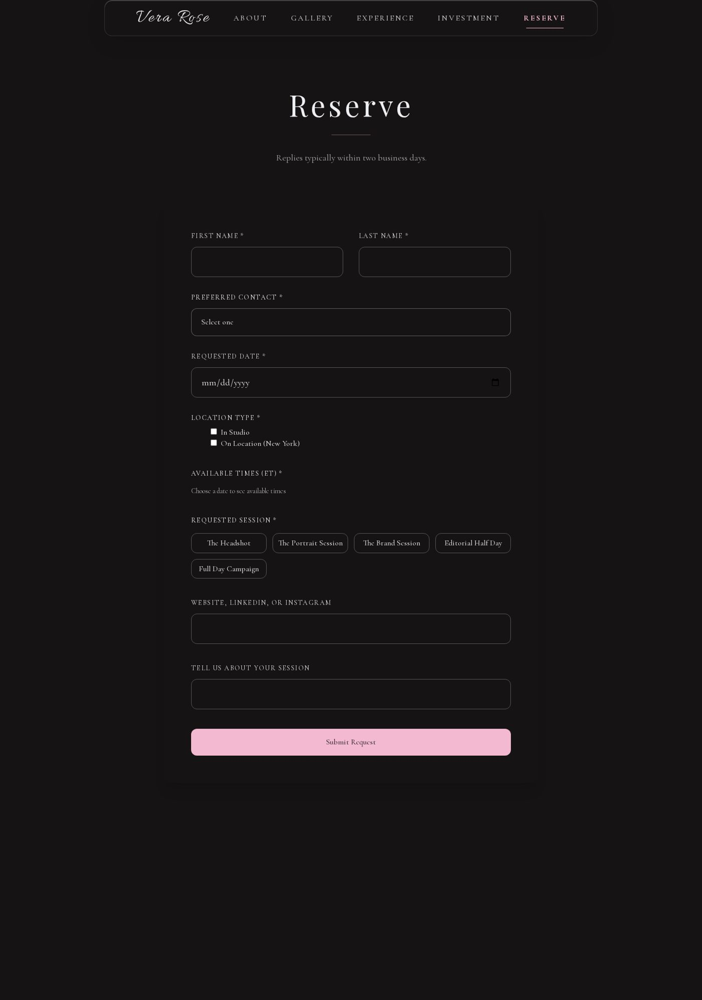
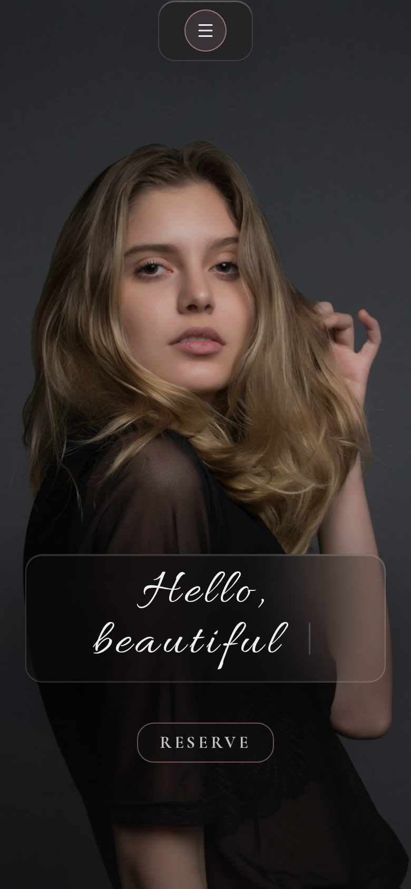

# Vera Rose Studio

**A luxury portrait & brand photography studio site — dark-first, glassmorphism design system, full booking inquiry flow.**



Vera Rose Studio is a fictional New York photography studio created as a portfolio
showcase. It demonstrates a complete, production-style brand site: an editorial
long-form home page, a lightbox gallery, service guidelines, transparent pricing,
and a validated booking inquiry form — all wrapped in a refined glassmorphism
design system with a dark default theme.

## Highlights

- **Dark-first theming** — the site renders dark on first paint (no light flash);
  the light theme is one tap away and each visitor's choice is remembered
- **Glassmorphism, done properly** — frosted panes with a hairline edge, an inset
  top highlight (light catching the rim), and deep soft shadows, used sparingly:
  the floating navbar and the hero title cards
- **Editorial type system** — Playfair Display headlines, Cormorant Garamond body,
  Allura script accents, letter-spaced uppercase micro-labels
- **Motion** — staggered fade-up reveals, a typed script headline, and a navbar
  that firms up (rose edge + stronger shadow) once you scroll
- **Booking inquiry flow** — preferred-contact validation (email *or* phone),
  date-driven time-slot availability (closed Sundays, Saturday mornings only),
  session picker, honeypot field, and a submit-timing bot check
- **Fully responsive** — dedicated mobile hero imagery and a glass mobile menu

## Pages

| Route | What it is |
| --- | --- |
| `/` | About — typed hero, long-form studio story, explore footer |
| `/gallery` | Editorial gallery with click-to-open lightbox |
| `/experience` | Session guidelines, numbered I–V |
| `/investment` | Session menu with pricing + the 3-step process |
| `/reserve` | Booking inquiry form (see Highlights) |
| `/privacy-policy` | Privacy & image-use policy |
| `/terms-service` | Booking terms, licensing, rescheduling |

## Screenshots

| Gallery | Investment |
| --- | --- |
|  |  |

| Experience | Reserve | Mobile |
| --- | --- | --- |
|  |  |  |

## Design system

| Token | Light | Dark (default) |
| --- | --- | --- |
| Background | `rgb(238 239 242)` | `rgb(22 19 20)` |
| Primary (rose) | `rgb(184 96 128)` | `rgb(243 185 208)` |
| Foreground | `rgb(22 19 20)` | `rgb(238 239 242)` |
| Secondary | `rgb(206 212 224)` | `rgb(206 212 224)` |

Fonts: Playfair Display (headers) · Cormorant Garamond (body) · Allura (script)

The glass treatment lives in `src/app/globals.css` as reusable `.glass-card` /
`.glass-nav` classes — a 1px translucent border, inset top highlight, and layered
shadow on top of `backdrop-blur`, with dark-mode variants.

## Tech stack

Next.js 16 · React 19 · TypeScript · Tailwind CSS 4 · Framer Motion · Lucide icons

Production builds are a static export (`output: "export"`), so the site deploys
to GitHub Pages, Vercel, Netlify, or any static host.

## Run it locally

```bash
npm install
npm run dev     # http://localhost:3000
npm run build   # static export in out/
```

## Notes

- Photography is Unsplash stock (free to use), kept in `public/images/` so it can
  be swapped for real studio work without touching code.
- The Reserve form is a front-end showcase: it validates like the production
  version and stores inquiries in the browser. It is structured so a bookings
  database + email notification backend can be reconnected at the submit handler.
- Vera Rose Studio is a fictional business created for portfolio purposes.
